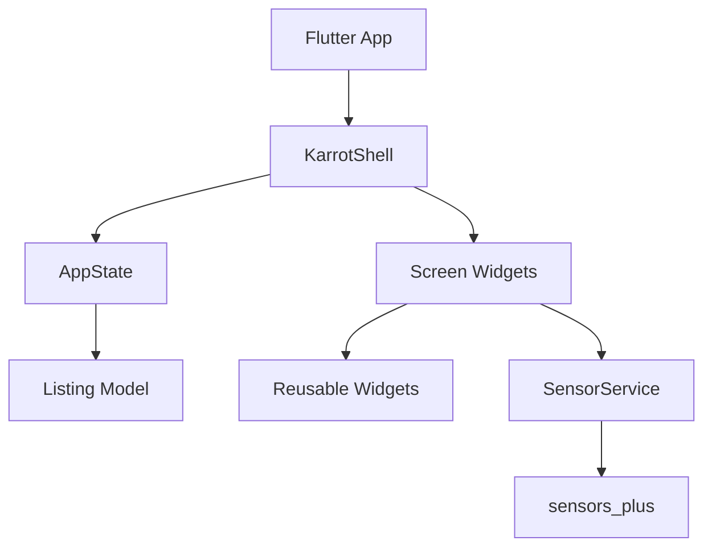

# AI & AR 기반 차세대 중고거래 플랫롭
2026-하반기 모바일프로그래밍 프로젝트 (작성자: 유익)

Flutter와 Dart를 활용하여 구현한 당근마켓 스타일의 모바일 중고거래 플랫폼입니다. 상품 탐색, 상품 상세 확인, 채팅, 동네 설정, 상품 등록, 로그인 OTP 화면과 센서 기반 AR 스타일 상품 미리보기 흐름을 하나의 모바일 앱에서 경험할 수 있도록 구성했습니다. 현재 프로젝트는 학습 오프라인 데모 기준으로 합니다. 실제 회원 인증, 서버 통신, 결제, 카메라 촬영 및 ARCore/ARKit 연동은 포함 될 예정이며, 일부 기능은 임시 데이터와 상태로 동작입니다
## 1. 프로젝트 개요
- Flutter 위젯 기반 모바일 UI 구성 연습
- 중고거래 서비스의 주요 사용자 흐름 구현
- 화면과 상태를 기능별 파일로 분리하는 구조 학습
- 기기 센서 데이터를 활용한 AR 스타일 인터렉션 구현
### 사용자 흐름
```
학슴 상품 목록
↓
상품 상세 확인
    ├── AR로 보기
    └── 채팅하기

나의 당근
    ├── 로그인 / 회원가입
    └── 앱 설정

상품 작성
    └── 작성 완료 → 홈 목록에 새 상품 추가
```

## 2. 주요 특징
### 중고거래 기본 기능
- 우리 동네 인기 매물 목록
- 상품 이미지 ·제목·위치·등록 시간·가격 표시
- 상품 상세 정보와 거래 희망 장소 표시
- 상품 검색 화면과 추천 검색어 UI
- 상품 등록 화면과 임시 상품 추가 기능

### 사용자 및 거래 기능
- 하단 네비게이션을 통한 홈·검색·채팅·나의 당근 이동
- 채팅방 목록과 채팅 상세 화면
- 샘플 메시지 전송 상태 반영
- 로그인·회원가입 및 OTP 인증 화면 흐름
- 동네 설정과 앱 설정 화면

### AR 스타일 기능
- 상품 상세 화면에서 AR 미리보기 화면으로 이동
- `sensors_plus`를 활용한 가속도 센서 이벤트 수신
- 휴대폰 기울기에 따른 상품 카드 이동·회전
- 센서를 사용할 수 없을 때 반복 애니메이션으로 대체
- Canvas 기반 AR 격자와 조준선 렌더링

## 3. 프로젝트 아키텍처 및 워크플로우 
앱은 화면, 상태, 모델, 공통 위젯, 외부 센서 서비스를 분리하는 구조로 구성했습니다.

### 화면 흐름
### 현재 데이터 처리

## 4. 디렉터리 구조
```text
lib/
├── config/
│   └── app_theme.dart             # 앱 공통 색상과 Material 테마
├── models/
│   ├── app_screen.dart             # 앱 화면 열거형
│   └── listing.dart                # 상품 모델과 상품 종류
├── providers/
│   └── app_state.dart              # 화면 이동 및 샘플 상태 관리
├── screens/
│   ├── karrot_shell.dart            # 앱 화면 라우팅과 하단 네비게이션
│   ├── home_view.dart               # 홈 상품 목록
│   ├── search_view.dart             # 검색 화면
│   ├── article_view.dart            # 상품 상세 화면
│   ├── chat_view.dart               # 채팅 목록
│   ├── chat_room_view.dart          # 채팅방 상세
│   ├── write_view.dart              # 상품 등록
│   ├── profile_view.dart            # 나의 당근
│   ├── region_view.dart             # 동네 설정
│   ├── settings_view.dart           # 앱 설정
│   ├── login_view.dart              # 로그인·회원가입
│   ├── otp_view.dart                # OTP 인증
│   └── ar_preview_view.dart         # 센서 기반 AR 스타일 화면
├── services/
│   └── sensor_service.dart          # 가속도 센서 스트림 제공
└── widgets/
    ├── listing_tile.dart             # 상품 카드와 상품 일러스트
    ├── chat_bubble.dart              # 채팅 말풍선
    ├── profile_tile.dart             # 프로필 메뉴 항목
    ├── setting_row.dart              # 설정 메뉴 항목
    ├── form_row.dart                 # 상품 등록 입력 항목
    └── ar_painters.dart              # AR 격자·조준선 Painter
```

## 5. 설치 및 준비
### 요구 사항
- Flutter SDK
- Dart SDK
- Android Studio 또는 iOS 개발 환경
- 가속도 센서를 확인할 수 있는 실제 모바일 기기 또는 에뮬레이터

### 실행 방법
```bash
flutter pub get
flutter run
```

`pubspec.yaml`에는 Flutter 기본 패키지와 센서 처리를 위한 `sensors_plus` 의존성이 필요합니다.

## 6. 사용 방법
### 상품 탐색
1. 홈 화면에서 상품 목록을 확인합니다.
2. 상품 카드를 누르면 상품 상세 화면으로 이동합니다.
3. 상세 화면에서 `AR로 보기`를 누르면 상품 미리보기 화면이 열립니다.
4. `채팅하기`를 누르면 판매자 채팅방으로 이동합니다.

### 상품 등록
1. 홈 화면의 `+` 버튼을 누릅니다.
2. 상품 등록 화면에서 제목·가격·카테고리 입력 영역을 확인합니다.
3. `작성 완료`를 누르면 샘플 상품이 목록 맨 앞에 추가됩니다.

### 로그인 흐름
1. `나의 당근` 탭으로 이동합니다.
2. `로그인 / 회원가입` 버튼을 누릅니다.
3. 휴대폰 번호 입력 화면에서 `인증번호 받기`를 누릅니다.
4. OTP 화면에서 `확인`을 누르면 로그인 상태로 전환됩니다.

## 7. 소스 파일 상세 설명
| 파일 | 역할 |
|---|---|
| `app_theme.dart` | 앱 전역 색상과 Material 디자인 테마 정의 |
| `app_screen.dart` | 홈·검색·채팅·프로필·AR 등 화면 상태 정의 |
| `listing.dart` | 상품명, 위치, 시간, 가격, 카테고리, 찜 상태 보관 |
| `app_state.dart` | 상품 샘플 데이터, 화면 이동, 로그인 상태 관리 |
| `karrot_shell.dart` | 화면 라우팅, 뒤로 가기, 하단 네비게이션 관리 |
| `listing_tile.dart` | 상품 목록 카드와 상품별 Canvas 썸네일 표시 |
| `ar_preview_view.dart` | 가속도 센서와 애니메이션을 활용한 AR 스타일 UI |
| `sensor_service.dart` | 가속도 센서 스트림 생성 및 추상화 |
| `ar_painters.dart` | AR 배경 격자와 중앙 조준선 직접 그리기 |

## 8. 현재 구현 범위 및 확장 계획
현재 구현은 화면 흐름과 사용자 인터랙션을 확인하기 위한 오프라인 프로토타입입니다.
향후 확장할 기능은 다음과 같습니다.
- Firebase 또는 Spring Boot 기반 회원 인증
- 서버 연동 상품 등록 및 이미지 업로드
- 실제 검색어 기반 상품 검색
- WebSocket 기반 실시간 채팅
- 카메라 촬영 및 이미지 저장
- ARCore·ARKit 또는 WebXR 기반 실제 공간 인식
- 거래 알림, 안전결제, 신고 기능
- 상품별 찜 상태와 판매 내역 저장

## 9. 참고 기술
- **Dart**: Flutter 앱 개발 언어
- **Flutter**: 크로스플랫폼 모바일 UI 프레임워크
- **Material 3**: 앱 전역 UI 컴포넌트와 테마
- **sensors_plus**: 가속도 센서 이벤트 수신
- **CustomPainter**: 상품 일러스트와 AR 격자·조준선 렌더링
- **StatefulWidget / setState**: 현재 데모의 로컬 상태 관리

## 라이선스
본 프로젝트는 모바일 프로그래밍 학습 및 캡스톤 디자인 발표를 위한 프로젝트입니다. 외부 이미지·패키지·서비스를 실제 배포에 사용할 경우 각 라이선스와 사용 조건을 별도로 확인해야 합니다.
